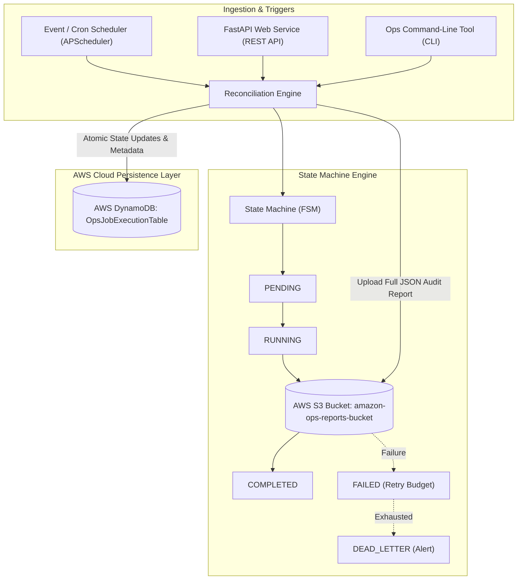

# OpsPulse: Cloud-Native Automated Workflow & Data Reconciliation Engine

[](https://github.com/sisodevaibhav11/cloudops-workflow-engine/actions)
[]()
[]()
[]()

> A resilient, cloud-native operational task automation service designed to eliminate manual data audits, detect financial & transactional discrepancies across downstream services, enforce deterministic state transitions via a finite state machine (FSM), store immutable audit artifacts in **AWS S3**, and track transactional execution metadata in **AWS DynamoDB**.

---

## 🏛️ System Architecture



---

## 🚀 Key Features

* **Deterministic Workflow State Machine:** Enforces strict transition sequences (`PENDING -> RUNNING -> VALIDATING -> COMPLETED / FAILED`), preventing illegal transitions or corrupted states.
* **Resilient Retry & Dead-Letter Escalation:** Implements automatic failure handling with configurable retry budgets. When retries are exhausted, tasks are escalated to a `DEAD_LETTER` state for operational intervention.
* **Transactional AWS DynamoDB Persistence:** Tracks job execution metadata, atomic timestamps, and metrics using partition keys (`job_id`) and reserved-keyword aliasing with `ExpressionAttributeNames`.
* **Immutable AWS S3 Audit Archival:** Formats and streams complete discrepancy audit reports to S3 with content hashing and metadata tags.
* **Automated Cron Scheduler:** Schedules recurring batch verification jobs (e.g., daily 02:00 UTC reconciliation) to automate manual configuration toil.
* **Dual Interface (REST API & CLI):** Exposes FastAPI endpoints for service-to-service integration and an internal CLI tool for operations teams.
* **100% Mocked Cloud Testing (Moto & PyTest):** Achieves **94% test coverage** without needing an active credit card or paying AWS fees.

---

## 🛠️ Tech Stack

* **Language:** Python 3.12
* **Cloud & SDK:** AWS S3, AWS DynamoDB, `boto3`, `botocore`
* **Workflow & Schedulers:** Custom FSM, `APScheduler`
* **API & Web Services:** FastAPI, Pydantic v2, Uvicorn, HTTPX
* **Testing & Mocks:** PyTest, PyTest-Cov, `moto` (AWS In-Memory Mock)
* **DevOps / CI:** GitHub Actions CI/CD pipeline

---

## 📦 Getting Started

### 1. Setup Virtual Environment
```bash
python -m venv .venv
# Windows:
.\.venv\Scripts\Activate.ps1
# Linux / macOS:
source .venv/bin/activate

pip install -r requirements.txt
```

### 2. Run the Full Test Suite (19 tests, 94% coverage)
```bash
pytest -v --cov=src --cov-report=term-missing tests/
```

### 3. Run via CLI
```bash
# Execute batch reconciliation on sample payload
python src/cli.py run --file data/sample_payload.json --job-id JOB-OPS-001

# Inspect DynamoDB execution state
python src/cli.py status --job-id JOB-OPS-001

# Fetch S3 audit report
python src/cli.py report --job-id JOB-OPS-001
```

### 4. Run the REST API Web Service
```bash
uvicorn src.api:app --reload --port 8000
```
Visit the interactive Swagger UI at: `http://127.0.0.1:8000/docs`

---

## 🧪 Test Results & Coverage

```text
Name                   Stmts   Miss  Cover   Missing
----------------------------------------------------
src\__init__.py            1      0   100%
src\api.py                59     11    81%   20-24, 78-79, 102, 109, 117-118
src\cli.py                47      5    89%   47-48, 55-56, 63
src\config.py              9      0   100%
src\reconciler.py         57      0   100%
src\scheduler.py          29      0   100%
src\state_machine.py      39      0   100%
src\storage.py            97      4    96%   21, 68, 74, 96
----------------------------------------------------
TOTAL                    338     20    94%
======================= 19 passed in 17.38s =======================
```
